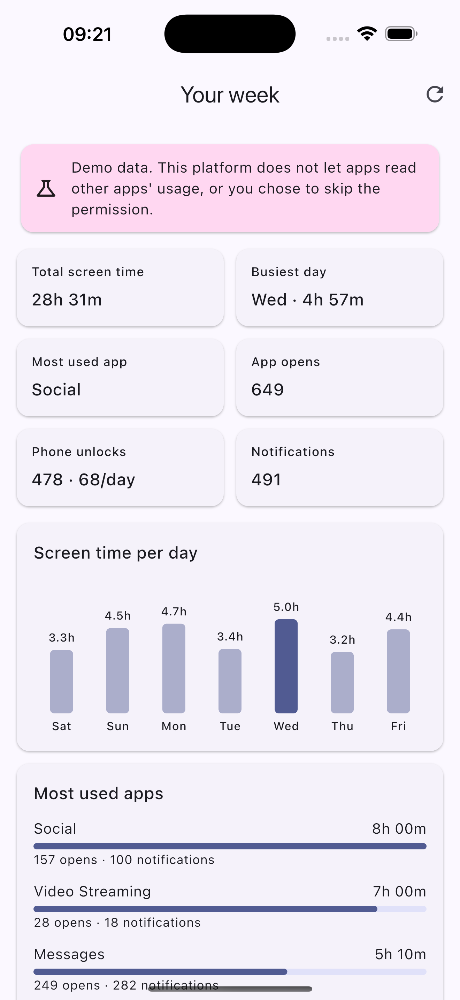
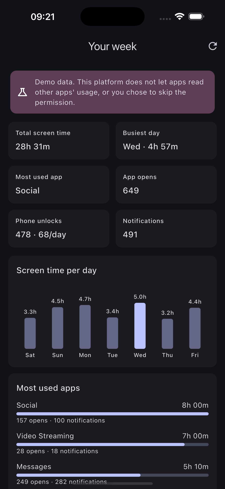
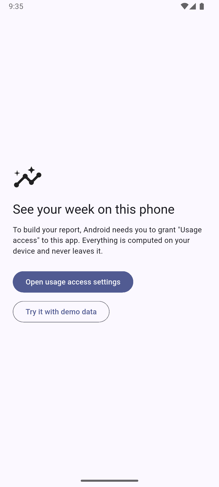
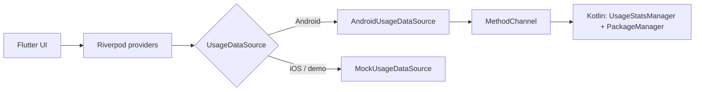

# Activity Report

A Flutter app that answers one question: **"What did I do on my phone this week?"**

> *Which trade-offs would you make to offer a solution that is comprehensive, efficient and/or practical, and why?*

My short answer: **practical and honest beats comprehensive.** I built a small report that is real on Android, clearly labelled as demo on iOS, and I documented exactly where the platforms stop me.

## What the app shows

- Total screen time, busiest day, most used app, number of app opens, phone unlocks, notifications
- Screen time per day (7-day bar chart)
- Top 5 apps with time, opens and notifications
- Apps installed and removed during the week

| Light | Dark |
|---|---|
|  |  |

*Screenshots use the demo data source (iOS simulator).*

On Android, the app first explains why it needs Usage access:



## Key decisions and trade-offs

| Decision | Why | What I gave up |
|---|---|---|
| **Small scope**: 6 metrics instead of the full idea list | A few metrics that are correct are worth more than many that are shaky | Highscores, video time and ad exposure |
| **Skipped highscores / video time / ad exposure** | Other apps keep this data inside their own sandbox. Neither OS exposes it to a third-party app. Only the apps themselves (or the OS vendor) could produce it | Completeness |
| **On-device only, no backend** | The data is very personal. Not sending it anywhere is the best privacy story and removes a whole class of work (auth, storage, GDPR) | Cross-device history, sharing |
| **Android = real data, iOS = demo data** | See "Platform reality" below | Parity between platforms |
| **One `UsageDataSource` interface** (real + mock implementations) | UI and tests never know where data comes from. Adding a real iOS source later changes one file | A little indirection for a small app |
| **No repository layer** | With a single interface and one screen, a repository would only forward calls | Would be added if caching or a second source appeared |
| **Riverpod** for state | Small, testable, no `BuildContext` needed for data | Another dependency |
| **Hand-drawn bar chart** (no chart package) | One simple chart; avoids a dependency | Animations, tooltips, accessibility |
| **Compute everything in one pass over `UsageEvents`** | One query, one loop. Cheap enough to run on demand, so no background service | Data is only as fresh as the last refresh |

## Architecture



```
lib/
  models/report.dart        plain data + derived stats (testable, no Flutter)
  data/                     UsageDataSource + Android + Mock implementations
  state/providers.dart      which source is active, permission, report
  ui/                       permission gate, permission screen, report page
android/.../MainActivity.kt channel: hasPermission, openPermissionSettings, getWeeklyReport
test/                       unit tests for derived stats and channel parsing
```

## Platform reality

**Android** gives apps a real API: `UsageStatsManager`, protected by the special "Usage access" permission that the user grants in system settings. The app explains why it needs it and offers a demo mode if the user declines.

**iOS** does not let an app read other apps' usage, opens, notifications or installs. The only official route is Apple's Screen Time APIs (`FamilyControls` / `DeviceActivity`), which:

1. require a special entitlement that Apple approves manually,
2. need native Swift app extensions, and
3. never hand over raw numbers: they only let you embed Apple's own report view.

So a custom-designed report like this one cannot be built on iOS today. On iOS the app therefore runs on clearly labelled demo data. I chose that over faking it or shipping a half-working integration.

## How the Android numbers are computed

- **Time**: I pair `MOVE_TO_FOREGROUND` / `MOVE_TO_BACKGROUND` events and add the interval to each day it overlaps, so a session crossing midnight is split correctly. Only one app is on screen at a time, so a new foreground app, screen off, lock or shutdown closes the open session. Without this, a missing background event (process killed) kept a session open for days and pushed a day past 24 hours; I found that by testing on a real emulator.
- **Opens**: foreground events count as an open only if the app was away for more than 5 seconds. Without this, moving between screens inside one app would inflate the count.
- **Unlocks**: `KEYGUARD_HIDDEN` events (public since Android 9), counted per day. On older versions the tile is hidden.
- **Installed**: `firstInstallTime` within the 7-day window.
- **Removed**: Android keeps no uninstall history, so the app stores the list of installed apps and diffs it on each report. Removals are therefore only detected **from the first launch onward**.
- Only apps with a launcher icon are counted (no system services), and the app itself is excluded.

## Known limitations (honest list)

- **Notification counts are best effort.** The only source on Android without a second permission is a hidden `UsageEvents` type (`NOTIFICATION_INTERRUPTION`) that devices and OS versions do not always record. When no counts come back, the app hides the notification metrics instead of showing a misleading `0`. The proper fix is a `NotificationListenerService` (extra permission, counts only from the moment it is enabled).
- Foreground-service time (e.g. music playing with the screen off) is not counted as screen time.
- The 7-day window is "today and the 6 days before", not a calendar week.
- I have not tested on a wide range of Android versions and OEM skins.

## If I had more time

1. `NotificationListenerService` for reliable notification counts.
2. Week-over-week comparison (needs a 14-day window; today the window is the `DAYS` constant in `MainActivity.kt` and `WeeklyReport.days`, so it would become a parameter).
3. A native iOS `DeviceActivityReport` extension to show Apple's own report inside the app, once the entitlement is granted.
4. Home-screen widget with today's screen time.
5. Integration test that drives the permission flow.

## Run it

```bash
flutter pub get
flutter test
flutter run            # Android device: real data after granting Usage access
                       # iOS / simulator / "demo data" button: mock data
```

### Android setup (already applied in this repo)

`android/app/src/main/AndroidManifest.xml` needs, inside `<manifest>`:

```xml
<uses-permission android:name="android.permission.PACKAGE_USAGE_STATS"
    tools:ignore="ProtectedPermissions" />

<queries>
    <intent>
        <action android:name="android.intent.action.MAIN" />
        <category android:name="android.intent.category.LAUNCHER" />
    </intent>
</queries>
```

and `xmlns:tools="http://schemas.android.com/tools"` on the `<manifest>` tag. The `<queries>` block lets the app see launchable apps on Android 11+ without the broad `QUERY_ALL_PACKAGES` permission.
